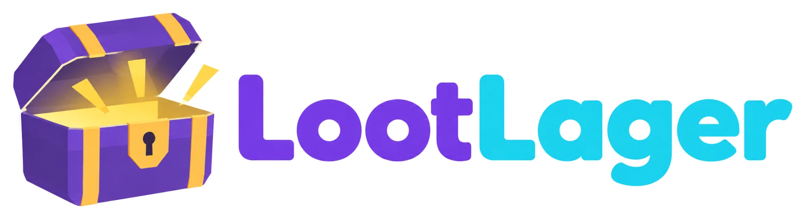

# Projektplanung – Gründung unseres Onlineshops

> **Aufgabe (laut Tafel):** 5 Gruppen · Logo (KI) · Firmenname · Rechtsform · Suche vom Anbieter · Präsentation (1. Folie …)
>
> Tafel-Skizze: *Suche Anbieter → HP* – wir suchen einen Anbieter, mit dem wir unsere Homepage bzw. unseren Onlineshop bauen.
>
> **Die Gründung ist fiktiv** und nur für das Fach E-Commerce. Wir melden nichts an, prüfen keine Register und bezahlen nichts.

## Stand: alles gebaut, noch offen sind Upload und Probelauf

Shop, Präsentation (8 Folien) und Nutzwertanalyse sind fertig. **Was ihr selbst noch machen müsst:**
- [ ] Shop bei Netlify hochladen und den Namen `lootlager` sichern (Anleitung in Abschnitt 6).
- [ ] Präsentation einmal in PowerPoint öffnen und alle Folien durchklicken
- [ ] Spickzettel lernen: Name (Abschnitt 2), Rechtsform (Abschnitt 3) und Anbieter (Abschnitt 5)
- [ ] Probelauf mit Stoppuhr (die Sprechtexte dauern zusammen etwa 5 bis 6 Minuten, ohne Nachfragen und Live-Demo), danach Rollen in Abschnitt 8 bestätigen
- [ ] Bei der Lehrkraft nachfragen, wie lange die Präsentation dauern darf
- [ ] Gruppennummer 4 noch einmal prüfen

### Phase 1 (erledigt): Folie 1

Die Lehrkraft hat gesagt:
- **Folie 1 ist der Anfang der Präsentation.** Darauf müssen stehen: **Firmenlogo, Firmenname, Rechtsform.**
- Zusätzlich überlegen wir uns einen **Markennamen**. Er darf genauso heißen wie die Firma.
- Die Lehrkraft lässt **irgendein Gruppenmitglied** vorstellen und fragt nach, z. B. **„Warum habt ihr diese Rechtsform gewählt?“**. Deshalb muss **jede und jeder** die Begründung können (siehe [Spickzettel](#spickzettel-fragen-der-lehrkraft-zur-rechtsform)).

- [x] Geschäftsidee festlegen (Abschnitt 1)
- [x] Firmenname + Markenname festlegen (Abschnitt 2)
- [x] Rechtsform festlegen (Abschnitt 3)
- [x] Geschäftsführung bestimmen → Nick und Luca
- [x] Logo mit ChatGPT erstellen → [`assets/logo-lootlager.png`](assets/logo-lootlager.png)
- [x] Folie 1 bauen → [`praesentation/LootLager_Praesentation_v1.pptx`](praesentation/LootLager_Praesentation_v1.pptx) und [`_v2.pptx`](praesentation/LootLager_Praesentation_v2.pptx)
- [x] Auf Folie 1 Gruppennummer und Namen eintragen → Gruppe 4, Nick und Luca (Gruppennummer bitte noch einmal prüfen)

### Phase 2 (erledigt): Anbieter, Homepage, restliche Folien

- [x] Anbieter auswählen → **Netlify**, gebaut mit Claude Code (Nutzwertanalyse in Abschnitt 5, Excel-Datei in `praesentation/`)
- [x] Homepage bauen → Ordner [`shop/`](shop/) mit Logo, Name, Domain und 5 Produkten (Abschnitt 6)
- [x] Folien 5–7 bauen (Anbietersuche als Excel-Tabelle, Entscheidung + Startseite, Fazit + Quellen)
- [x] Rollen verteilen → Vorschlag in Abschnitt 8

**Erledigt, weil die Gründung fiktiv ist:**
- [x] Namensprüfung in Handelsregister, DPMA und Social Media → wir nehmen an, dass alles frei ist (Abschnitt 2)
- [x] Domain → `lootlager.de` ist in echt schon vergeben, für das Projekt tun wir so, als wäre sie frei (Abschnitt 2)
- [x] Preise gegenprüfen → Netlify direkt beim Anbieter, der Rest aus Preisvergleichen (Abschnitt 5)

---

## ✅ Unsere Firma auf einen Blick

| | |
|---|---|
| **Firmenname** | **LootLager UG (haftungsbeschränkt)** |
| **Markenname** | **LootLager** (gleich wie die Firma) |
| **Rechtsform** | **Unternehmergesellschaft (haftungsbeschränkt)** |
| **Slogan** | „Level up dein Setup.“ |
| Was wir verkaufen | Gaming-Zubehör mit **Custom Designs**, 5 Produkte: XXL-Mauspad, Controller-Skin, Custom Keycaps, LED-Schild, Headset-Halter |
| Zielgruppe | Gamer und Streamer, 16–30 Jahre |
| Was uns besonders macht | Jedes Produkt mit eigenem Design: Kunden laden ihr Motiv hoch oder lassen es von uns gestalten. Schneller Versand aus Deutschland |
| Gruppe | Gruppe 4: Nick und Luca |
| Gesellschafter | Nick und Luca, je 50 % |
| Stammkapital | 1.000 € (fiktiv), je 500 € von Nick und Luca |
| Geschäftsführung | Nick und Luca (gemeinsam) |
| Homepage | **Netlify** (Free-Tarif), gebaut mit Claude Code (siehe Abschnitte 5 und 6) |
| Domain | `lootlager.de` (fiktiv, in echt schon vergeben). Bei Netlify kostenlos: `lootlager.netlify.app` |
| Farben | Violett `#7C3AED` · Türkis `#22D3EE` · Dunkelblau `#111827` |

**Was der Name bedeutet:** „Loot“ ist in Videospielen die Beute, also die Belohnung, die man findet. „Lager“ steht für unseren Shop, in dem alles bereitliegt. **LootLager ist das Lager voller Beute für dein Gaming-Setup.** Das doppelte L macht den Namen leicht merkbar.

---

## 0. Überblick – Arbeitspakete

| # | Arbeitspaket | Ergebnis | Verantwortlich | Status |
|---|---|---|---|---|
| 1 | Geschäftsidee | Sortiment + Zielgruppe in einem Satz | Nick und Luca | ✅ |
| 2 | Firmenname | Name inkl. Rechtsformzusatz, geprüft | Nick und Luca | ✅ (fiktiv: Name ist frei) |
| 3 | Rechtsform | Entscheidung + Begründung | Nick und Luca | ✅ |
| 4 | Logo (KI) | Logo als PNG, Tool + Prompt notiert | Nick und Luca | ✅ |
| 5 | Anbietersuche | Vergleich von 4 Anbietern + Entscheidung | Nick und Luca | ✅ Netlify |
| 6 | Homepage | fertiger Shop im Ordner `shop/` | Nick und Luca | ✅ gebaut, Upload zu Netlify offen |
| 7 | Präsentation | Foliensatz + ein Probelauf | Nick und Luca | ◐ Folien fertig, Probelauf offen |

**Reihenfolge:** 1 → 2 und 3 parallel → 4 → 5 → 6 → 7
(Das Logo kommt erst nach dem Namen, weil der Name meist im Logo steht.)

**Phase 1:** Pakete 1–4 → Folie 1
**Phase 2:** Pakete 5–7 → Anbieter auswählen, Homepage bauen, restliche Folien

---

## 1. Geschäftsidee

Leitfragen: *Was verkaufen wir? An wen? Warum bei uns und nicht bei Amazon?*

| Idee | Sortiment | Zielgruppe | Namensideen |
|---|---|---|---|
| Nachhaltiger Alltag | Trinkflaschen, Brotdosen, feste Seife, Bienenwachstücher | Umweltbewusste, 18–35 | Grünstück, Kreislauf & Co. |
| Gaming-Zubehör | Mauspads, Headset-Halter, LED-Leisten, Kabelmanagement | Gamer, 14–30 | PixelPort, Levelgear |
| Kaffee & Zubehör | Spezialitätenkaffee, Handfilter, Mühlen | Kaffeeliebhaber, 25–50 | Bohnenwerk, Röstpunkt |
| Sneaker-Pflege | Reinigungssets, Imprägnierspray, Schnürsenkel | Sneaker-Fans, 16–35 | SoleCare, Frischsohle |

Die Namen sind nur Startpunkte. Ob es sie schon gibt, prüfen wir in Abschnitt 2.

**Unsere Entscheidung:** Gaming-Zubehör mit Custom Designs. Gamer und Streamer (16–30) bekommen bei uns Zubehör mit ihrem eigenen Design, selbst hochgeladen oder von uns gestaltet. Unsere 5 Produkte mit Preisen stehen in Abschnitt 6.

---

## 2. Firmenname

**Rechtliche Anforderungen (HGB / GmbHG):**
- Der Name muss **unterscheidungskräftig** sein und darf **nicht irreführen** (§ 18 HGB).
- Der **Rechtsformzusatz** ist Pflicht (§ 19 HGB, § 4 bzw. § 5a GmbHG), z. B. „… GmbH“ oder „… UG (haftungsbeschränkt)“.

**Ein guter Shop-Name ist:** kurz, leicht zu buchstabieren, passend zum Sortiment und als Domain noch frei.

**Prüf-Checkliste:**
- [x] Handelsregister – gibt es die Firma schon? → fiktiv: nein. Echt prüfen würde man auf [handelsregister.de](https://www.handelsregister.de), „Normale Suche“, Firma: `LootLager`
- [x] Marken – ist der Name geschützt? → fiktiv: nein. Echt prüfen würde man im [DPMAregister](https://register.dpma.de/DPMAregister/marke/basis) und in [EUIPO eSearch](https://euipo.europa.eu/eSearch/)
- [x] Domain – ist `lootlager.de` frei? → **in echt nein**: Die Abfrage bei der [DENIC](https://www.denic.de/service/whois-service) zeigt am 13.10.2026 „vergeben“. Für unser fiktives Projekt tun wir so, als wäre sie frei. Bei Netlify war `lootlager.netlify.app` am selben Tag noch frei
- [x] Social Media – sind Instagram- und TikTok-Namen frei? → fiktiv: ja (`@lootlager`)
- [x] Kurze Websuche nach dem Namen (06.10.2026: kein Shop „LootLager“ gefunden)

> **Fiktive Gründung:** Unser Shop ist ein Projekt für das Fach E-Commerce. Deshalb prüfen wir die Register nicht echt, sondern **nehmen an, dass Firmenname, Marke und Social-Media-Namen frei sind**. Nur die Domain haben wir echt nachgeschaut: `lootlager.de` ist schon vergeben. In der Präsentation erklären wir trotzdem, wo man das prüfen würde (siehe Spickzettel unten).

**Vollständiger Firmenname:** `LootLager UG (haftungsbeschränkt)`

### Firmenname oder Markenname – was ist der Unterschied?

| | Firmenname (Firma) | Markenname (Marke) |
|---|---|---|
| Was ist das? | Der **rechtliche Name des Unternehmens**, unter dem es Geschäfte macht (§ 17 HGB) | Ein **Kennzeichen für Produkte**, das sie von denen anderer Anbieter unterscheidet (§ 3 MarkenG) |
| Wo steht er? | im Handelsregister, Impressum, auf Rechnungen und Verträgen | auf Produkten, Verpackungen, im Shop und in der Werbung |
| Rechtsformzusatz? | **ja, Pflicht** (z. B. „UG (haftungsbeschränkt)“) | nein |
| Schutz | durch Eintrag ins Handelsregister | durch Eintragung beim DPMA, 10 Jahre, verlängerbar |
| Beispiel | Henkel AG & Co. KGaA | Persil |
| Beispiel | dm-drogerie markt GmbH + Co. KG | Balea |

**Für uns:** Die Marke heißt genauso wie die Firma, nur ohne Rechtsformzusatz. Das ist laut Lehrkraft ausdrücklich in Ordnung.

**Unser Markenname:** `LootLager`

### Spickzettel: Fragen zu Name, Marke und Logo

**„Warum heißt ihr LootLager?“**
> „Loot“ ist in Videospielen die Beute, die man als Belohnung bekommt. „Lager“ steht für unseren Shop, in dem alles für dein Gaming-Setup bereitliegt. Der Name ist kurz, passt zu unserer Zielgruppe und ist durch das doppelte L leicht zu merken.

**„Was ist der Unterschied zwischen Firma und Marke?“**
> Die Firma ist der rechtliche Name unseres Unternehmens. Sie steht im Handelsregister und enthält die Rechtsform: LootLager UG (haftungsbeschränkt). Die Marke ist der Name, unter dem die Kunden unseren Shop und unsere Produkte kennen: LootLager. Bei uns heißen beide gleich, so erkennt man uns leichter wieder.

**„Was bedeutet euer Logo?“**
> Die Truhe ist eine Loot-Kiste wie in Videospielen: Wer bei uns bestellt, bekommt seine Belohnung. Violett und Türkis sind typische Gaming-Farben. Das Logo haben wir mit ChatGPT erstellt.

**„Habt ihr geprüft, ob es den Namen schon gibt?“**
> Unsere Gründung ist fiktiv, deshalb nehmen wir an, dass der Name frei ist. Eine kurze Websuche hat keinen Shop „LootLager“ gefunden. Bei einer echten Gründung würden wir im Handelsregister nach der Firma suchen und beim DPMA nach der Marke.

**„Was ist eure Domain? Ist die frei?“**
> Unsere Domain ist lootlager.de, also genau unser Markenname. In echt ist sie schon vergeben, das zeigt die Abfrage bei der DENIC. Weil unsere Gründung fiktiv ist, tun wir so, als wäre sie frei. Online stellen können wir den Shop trotzdem, über die kostenlose Netlify-Adresse lootlager.netlify.app.

---

## 3. Rechtsform

| Rechtsform | Gründer | Mindestkapital | Haftung | Für uns? |
|---|---|---|---|---|
| Einzelunternehmen | 1 | keins | unbeschränkt, mit Privatvermögen | ✗ wir sind zu zweit |
| GbR | ≥ 2 | keins | unbeschränkt, persönlich, jeder für alles | ✗ zu riskant |
| OHG | ≥ 2 | keins | unbeschränkt, persönlich | ✗ zu riskant |
| KG | ≥ 2 | keins | Komplementär unbeschränkt, Kommanditist bis zur Einlage | ~ möglich, aber ungleich |
| **GmbH** | ≥ 1 | 25.000 € (mind. 12.500 € bei Anmeldung eingezahlt) | nur Gesellschaftsvermögen | ✓ |
| **UG (haftungsbeschränkt)** | ≥ 1 | ab 1 €, komplett bar einzuzahlen | nur Gesellschaftsvermögen | ✓ |
| AG | ≥ 1 | 50.000 € | nur Gesellschaftsvermögen | ✗ zu aufwendig |

### Unsere Wahl: UG (haftungsbeschränkt)

**Argumente für die Präsentation:**
1. **Beschränkte Haftung** – Risiken im Onlinehandel (Abmahnungen, Retouren, unverkaufte Lagerware) treffen nicht unser Privatvermögen.
2. **Geringes Startkapital** – realistisch für Gründer ohne großes Vermögen.
3. **Zwei Gesellschafter** – Nick und Luca halten je 50 % und führen gemeinsam die Geschäfte.
4. **Wachstum möglich** – später Umwandlung in eine GmbH, sobald 25.000 € Stammkapital erreicht sind.

**Nachteile (ehrlich nennen – das macht die Präsentation stärker):**
- 25 % des Jahresüberschusses müssen in eine Rücklage (§ 5a Abs. 3 GmbHG).
- Notar und Handelsregister kosten Gebühren.
- Bei Lieferanten und Banken gilt die UG als weniger kreditwürdig als eine GmbH.

**Alternative:** Eine **GmbH**, wenn wir mit fiktivem Startkapital ab 25.000 € planen, denn sie wirkt seriöser.

### Spickzettel: Fragen der Lehrkraft zur Rechtsform

Jedes Gruppenmitglied muss diese Antworten in eigenen Worten sagen können.

**„Warum habt ihr die UG gewählt?“**
> Wir sind zwei Gründer und wollen nicht mit unserem Privatvermögen haften. Für eine GmbH fehlen uns aber die 25.000 € Stammkapital. Die UG gibt uns die beschränkte Haftung schon ab 1 € Stammkapital.

**„Was heißt ‚haftungsbeschränkt‘?“**
> Wenn die Firma Schulden hat, haftet nur das Vermögen der Gesellschaft. Unser privates Geld ist geschützt.

**„Warum keine GmbH?“**
> Für eine GmbH braucht man 25.000 € Stammkapital, bei der Anmeldung mindestens 12.500 €. Das haben wir als junge Gründer nicht. Sobald die UG 25.000 € Stammkapital hat, können wir sie zur GmbH machen.

**„Warum keine GbR oder OHG?“**
> Dort haftet jeder Gesellschafter unbeschränkt mit seinem Privatvermögen, und zwar auch für die Schulden der anderen. Im Onlinehandel ist das zu riskant, z. B. bei Abmahnungen oder wenn wir auf Ware sitzen bleiben.

**„Warum kein Einzelunternehmen?“**
> Ein Einzelunternehmen hat nur einen Inhaber, wir sind aber zu zweit. Außerdem haftet der Inhaber unbeschränkt.

**„Hat die UG auch Nachteile?“**
> Ja. Wir müssen jedes Jahr 25 % vom Gewinn zurücklegen, bis wir 25.000 € erreicht haben. Für die Gründung brauchen wir einen Notar und den Eintrag ins Handelsregister, das kostet Geld. Und manche Lieferanten und Banken vertrauen einer UG weniger als einer GmbH.

**„Wie viel Stammkapital habt ihr und wer sind die Gesellschafter?“**
> Unser Stammkapital beträgt 1.000 €. Nick und Luca sind die Gesellschafter und zahlen je 500 € ein.

**„Wer führt die Geschäfte?“**
> Wir beide: Nick und Luca sind gemeinsam Geschäftsführer. Die Geschäftsführung bestimmen die Gesellschafter, und das sind bei uns auch wir zwei.

**„Wie gründet man eine UG?“**
> Gesellschaftsvertrag beim Notar beurkunden lassen → Stammkapital einzahlen → Eintrag ins Handelsregister → Gewerbe anmelden → beim Finanzamt anmelden.

---

## 4. Logo (KI)

### Unser Logo ✅



Dateien: [`assets/logo-lootlager.png`](assets/logo-lootlager.png) (komplett) und [`assets/logo-lootlager-symbol.png`](assets/logo-lootlager-symbol.png) (nur die Truhe, z. B. als App-Icon)

**Tool:** ChatGPT. Falls das Bild-Limit erreicht ist, geht derselbe Prompt auch in Microsoft Copilot.

### Unser Prompt für ChatGPT (komplett kopieren und einfügen)

```text
Erstelle ein Logo für unseren Onlineshop „LootLager“.
Wir verkaufen Gaming-Zubehör (Mauspads, Headset-Halter, LED-Leisten,
Controller-Ständer) an Gamer und Streamer zwischen 16 und 30 Jahren.

Symbol: eine stilisierte, leicht geöffnete Schatztruhe wie eine
„Loot-Kiste“ aus Videospielen, aus der helles Licht nach oben strahlt.
Schriftzug: „LootLager“ rechts neben dem Symbol, in einer fetten,
abgerundeten, modernen Schrift. „Loot“ in Violett (#7C3AED),
„Lager“ in Türkis (#22D3EE).

Stil: flaches Vektor-Design, klare Formen, wenige Details,
modern und verspielt, aber professionell.
Hintergrund: reines Weiß.
Das Symbol muss auch ganz klein (als App-Icon) erkennbar sein.
Kein Fotorealismus, kein 3D, kein Slogan, kein weiterer Text,
keine Wasserzeichen. Schreibe den Namen genau so: LootLager
```

> **Warum stehen im Prompt LED-Leisten und Controller-Ständer?** Das Logo war zuerst fertig, das Sortiment haben wir danach festgelegt (siehe Abschnitt 6). Der Prompt steht hier so, wie wir ihn wirklich benutzt haben. Das Logo zeigt nur die Truhe und kein Produkt, deshalb passt es weiterhin. Eine gekürzte Fassung steht auf Folie 3.

### Folge-Prompts (danach im selben Chat eingeben)

| Wenn … | dann eingeben: |
|---|---|
| der Name falsch geschrieben ist | `Der Schriftzug ist falsch. Schreibe exakt: LootLager (L-o-o-t-L-a-g-e-r). Sonst nichts ändern.` |
| ihr eine andere Variante wollt | `Erstelle eine Variante mit denselben Farben, aber die Truhe im Pixel-Art-Stil wie in einem Retro-Videospiel.` |
| ihr eine dunkle Version wollt | `Erstelle dasselbe Logo auf dunklem Hintergrund (#111827) mit leichtem Neon-Leuchten um Symbol und Schrift.` |
| ihr nur das Symbol braucht | `Erstelle nur das Truhen-Symbol ohne Schrift, quadratisch, als App-Icon.` |
| der Hintergrund weg soll | `Gib mir das Logo als PNG mit transparentem Hintergrund.` |

Klappt der transparente Hintergrund nicht, entfernt ihr ihn in PowerPoint: Bild anklicken → **Bildformat** → **Freistellen**.

**Tipps:**
- KI schreibt Text oft fehlerhaft. Im Zweifel nur das **Symbol** generieren und den Schriftzug selbst in Canva oder PowerPoint setzen.
- 3–5 Varianten erzeugen und in der Gruppe abstimmen.
- **Tool und Prompt notieren**, denn beides gehört in die Präsentation.
- Rein KI-generierte Bilder sind in Deutschland mangels menschlicher Schöpfung meist **nicht urheberrechtlich geschützt**. Ein echtes Unternehmen würde das Logo deshalb als Marke anmelden. Außerdem gelten die Nutzungsbedingungen des Tools.

**Logo-Check (07.10.2026):**
- [x] Funktioniert es auch in Schwarz-Weiß? → Ja. Truhe und Schriftzug bleiben lesbar. In Graustufen ist „Lager“ etwas heller als „Loot“.
- [x] Ist es in kleiner Größe (z. B. als Browser-Tab-Icon) noch erkennbar? → Das Truhen-Symbol ist bei 32 px gut erkennbar, bei 16 px nur noch grob. Als Tab-Icon deshalb nur das Symbol verwenden, nicht das ganze Logo.
- [x] Passt es zu Name und Zielgruppe? → Ja. Die Loot-Truhe greift den Namen auf, Violett und Türkis sind typische Gaming-Farben.

### KI-Bilder für Shop und Präsentation ✅

**Tool:** Gemini (Google), erstellt am 13.10.2026. Die Originale und **alle 8 Prompts** liegen in [`assets/ki-bilder/`](assets/ki-bilder/PROMPTS.md).

| Bild | Wo wird es benutzt? |
|---|---|
| Truhe mit schwebenden Produkten | Shop: Banner oben auf der Startseite · Präsentation: Folie 1 |
| 5 Produktfotos (Mauspad, Controller-Skin, Keycaps, LED-Schild, Headset-Halter) | Shop: Produktkarten und Warenkorb · Präsentation: Folie 2 |
| Gaming-Schreibtisch bei Nacht | Shop: Bild über „Warum LootLager?“ · Präsentation: Folie 8 |
| Heller Hintergrund mit Gaming-Formen | nicht mehr benutzt (früher Hintergrund von Folie 1) |

**So sind die Prompts aufgebaut:** Format (z. B. 4:3), Motiv, Stil, Hintergrund, und am Ende, was nicht ins Bild soll (kein Text, keine Markenlogos, keine Menschen). In jedem Prompt stehen unsere Farben Violett `#7C3AED` und Türkis `#22D3EE`, damit alles zum Logo passt.

**„Woher sind die Bilder?“**
> Die haben wir mit Gemini erstellt, einer KI von Google. Das Logo ist von ChatGPT. Die Produkte gibt es noch nicht in echt, die Bilder zeigen, wie sie aussehen sollen. Die Prompts haben wir notiert.

---

## 5. Anbietersuche – womit bauen wir unsere Homepage?

> **Entscheidung der Gruppe (13.10.2026):** Wir nutzen **Netlify**. Die Seite bauen wir mit **Claude Code**. Die frühere Entscheidung für Shopify gilt nicht mehr.

### Kandidaten

| Anbieter | Typ | Sitz | Stärken | Schwächen |
|---|---|---|---|---|
| **Netlify** | Hosting für selbst gebaute Seiten | USA | Free-Tarif kostenlos, eigene Domain und HTTPS inklusive, in Sekunden online | kein Shopsystem: Warenkorb und Zahlung muss man selbst bauen, US-Anbieter (Daten können in die USA gehen) |
| Claude Code | KI-Programmierer (von Anthropic) | USA | baut die Seite nach unserer Beschreibung, jedes Design ist möglich | stellt die Seite nicht ins Internet, kostet ein Abo |
| Shopify | Mietshop (SaaS) | Kanada | alles fertig: Warenkorb, Zahlung, viele Apps | monatliche Kosten, beim Design an Vorlagen gebunden, Daten teils außerhalb der EU |
| Jimdo | Homepage-Baukasten mit Shop | Deutschland (Hamburg) | einfach, deutschsprachig, gut beim Datenschutz | wenig Freiheit beim Design, eingeschränkte Shop-Funktionen |

Früher auch angeschaut, aber nicht mehr in der Analyse: WooCommerce und Shopware 6 (eigener Server nötig), Wix (ähnlich wie Jimdo, aber teurer) und JTL-Shop (erst mit Warenwirtschaft sinnvoll).

### Preise (Stand 13.10.2026)

| Anbieter | Tarif für uns | Preis pro Monat | Was noch dazukommt |
|---|---|---|---|
| Netlify | Free | 0 € | 300 Credits im Monat inklusive, eine Veröffentlichung kostet 15 Credits. Größere Tarife: Personal 9 $, Pro 20 $ |
| Claude Code | im Abo Claude Pro enthalten | ca. 21 € (18 € netto) | brauchen wir nur, solange wir an der Seite bauen |
| Shopify | Basic | ca. 25 € bei jährlicher Zahlung, ca. 33 € bei monatlicher | Apps kosten teils extra. Ohne Shopify Payments 2 % Gebühr pro Verkauf |
| Jimdo | Onlineshop Basic | ab 18 € (je nach Laufzeit 15–22 €) | größere Tarife mit mehr Shop-Funktionen kosten mehr |

> **Woher die Preise kommen:** Netlify direkt von [netlify.com/pricing](https://www.netlify.com/pricing/). Shopify, Jimdo und Claude aus Preisvergleichen im Internet ([qualimero.com](https://qualimero.com/blog/shopify-preise), [trusted.de](https://trusted.de/jimdo-online-shop-kosten), [eesel.ai](https://www.eesel.ai/de/blog/claude-pro-pricing)), abgerufen am 13.10.2026. Für unsere fiktive Gründung reicht das. Bei einer echten Gründung würde man alle Preise noch einmal direkt beim Anbieter nachschauen, weil sie sich oft ändern.

### Recherchefragen – Antworten für Netlify

| Frage | Antwort |
|---|---|
| Was kostet es pro Monat? | Der Free-Tarif kostet 0 €. Es gibt keine Einrichtungsgebühr |
| Gibt es eine Grenze? | Ja, 300 Credits im Monat. Sind sie aufgebraucht, pausiert die Seite laut Preisvergleichen bis zum nächsten Monat, oder man wechselt in einen größeren Tarif |
| Können wir eine eigene Domain nutzen? | Ja, eine eigene Domain kann man kostenlos anschließen. HTTPS ist automatisch dabei. Ohne eigene Domain bekommt man eine Gratis-Adresse wie `lootlager.netlify.app` |
| Wo stehen die Server? | Netlify ist ein Unternehmen aus den USA. Die Seite wird über ein weltweites Netz von Servern ausgeliefert, in Europa z. B. aus Frankfurt. Der Hauptspeicher liegt in den USA, deshalb können Daten dorthin gehen. Einen Standort nur in der EU kann man nicht wählen (Quelle: Antworten von Netlify-Mitarbeitern im [Netlify-Forum](https://answers.netlify.com/t/can-i-set-my-netlify-server-location/41835), abgerufen am 13.10.2026) |
| Welche Zahlungsarten sind möglich? | Keine, Netlify ist kein Shopsystem. Eine Zahlung müssten wir selbst einbauen, z. B. mit PayPal oder Stripe |
| Gibt es Hilfe bei den Rechtstexten? | Nein. Dafür bräuchten wir ein Abo beim Händlerbund oder bei der IT-Recht Kanzlei (ca. 10–25 € im Monat). Selbst schreiben würden wir sie nicht, weil Fehler zu Abmahnungen führen können |
| Wie kommt die Seite online? | Ordner `shop` bei Netlify hochladen oder das GitHub-Projekt verbinden (siehe Abschnitt 6) |

### Nutzwertanalyse

Die Tabelle gibt es auch als Excel-Datei mit Formeln: [`praesentation/Nutzwertanalyse.xlsx`](praesentation/Nutzwertanalyse.xlsx). Auf Folie 5 ist sie als Excel-Tabelle zu sehen.

Punkte von 1 (schlecht) bis 10 (sehr gut). Gewichtete Punkte = Punkte × Gewichtung (in Klammern).

| Kriterium | Gewichtung | **Netlify** | Claude Code | Shopify | Jimdo |
|---|---|---|---|---|---|
| Kosten (Start + monatlich) | 25 % | 10 (2,50) | 6 (1,50) | 5 (1,25) | 6 (1,50) |
| Bedienbarkeit für Einsteiger | 15 % | 6 (0,90) | 6 (0,90) | 9 (1,35) | 9 (1,35) |
| Freiheit beim Design | 20 % | 9 (1,80) | 10 (2,00) | 7 (1,40) | 5 (1,00) |
| Warenkorb und Zahlung | 15 % | 4 (0,60) | 4 (0,60) | 10 (1,50) | 6 (0,90) |
| Domain und Hosting inklusive | 15 % | 9 (1,35) | 1 (0,15) | 9 (1,35) | 8 (1,20) |
| Datenschutz (DSGVO) | 10 % | 5 (0,50) | 5 (0,50) | 6 (0,60) | 9 (0,90) |
| **Summe** | **100 %** | **7,65** | 5,65 | 7,45 | 6,85 |

**Begründung der Punkte** (die Punkte haben wir selbst vergeben):
- **Kosten:** Netlify ist im Free-Tarif kostenlos. Claude Code und Jimdo kosten etwa 20 € im Monat, Shopify ab 25 € und dazu oft Apps.
- **Bedienbarkeit:** Shopify und Jimdo gehen ohne Technikwissen. Bei Netlify und Claude Code muss man verstehen, was ein Ordner mit HTML-Dateien ist.
- **Freiheit beim Design:** Mit eigenem Code geht alles. Bei Shopify ist man an Vorlagen und Apps gebunden, bei Jimdo noch stärker.
- **Warenkorb und Zahlung:** Bei Shopify ist alles fertig. Bei Netlify und Claude Code muss man Warenkorb und Zahlung selbst bauen.
- **Domain und Hosting:** Netlify und Shopify bringen Adresse, HTTPS und Server mit. Claude Code stellt keine Seite ins Internet, deshalb nur 1 Punkt.
- **Datenschutz:** Jimdo ist ein deutscher Anbieter. Netlify und Claude Code kommen aus den USA, Shopify aus Kanada.

**Wie sicher ist das Ergebnis?** Knapp: 7,65 gegen 7,45 Punkte. Es hängt an zwei Dingen, die wir offen sagen:
- **Gewichtung:** Uns sind die Kosten am wichtigsten (25 %). Mit 20 % für die Kosten und 20 % für „Warenkorb und Zahlung“ würde Shopify gewinnen (7,70 gegen 7,35).
- **Kosten von Netlify:** Die 10 Punkte gelten für den laufenden Betrieb (0 €). Zum Bauen brauchen wir Claude Code für ca. 21 € im Monat, aber nur, solange wir bauen.

**Unsere Entscheidung:** **Netlify (Free-Tarif)**, weil es nichts kostet und wir beim Design frei sind. Das passt zu unserer Idee mit den Custom Designs. Die Seite bauen wir mit **Claude Code**, denn Claude Code allein stellt keine Seite ins Internet. Shopify liegt knapp dahinter und wäre die bessere Wahl, sobald wir echte Bestellungen und Zahlungen brauchen.

**Laufende Kosten mit Netlify (geschätzt):**

| Posten | pro Monat |
|---|---|
| Netlify Free | 0 € |
| Domain `lootlager.de` | ca. 1–2 € |
| Rechtstexte-Abo (nur für einen echten Shop) | ca. 10–25 € |
| **Summe** | **ca. 1–27 €** |
| Claude Pro für Claude Code (nur solange wir bauen) | ca. 21 € |

### Spickzettel: Fragen der Lehrkraft zum Anbieter

**„Warum habt ihr Netlify gewählt?“**
> Netlify kostet im Free-Tarif nichts, und eine eigene Domain mit HTTPS ist dabei. Weil wir die Seite selbst bauen, sieht sie genau so aus, wie wir wollen. Das passt zu unseren Custom Designs.

**„Wie seid ihr vorgegangen?“**
> Wir haben vier Möglichkeiten mit einer Nutzwertanalyse in Excel verglichen. Jedes Kriterium hat eine Gewichtung, die Kosten zählen am meisten. Netlify hat mit 7,65 Punkten gewonnen, knapp vor Shopify mit 7,45.

**„Wie rechnet die Excel-Tabelle?“**
> Jeder Anbieter bekommt pro Kriterium 1 bis 10 Punkte. Die Formel SUMMENPRODUKT multipliziert die Punkte mit der Gewichtung und zählt alles zusammen.

**„Claude Code ist doch kein Anbieter für Homepages?“**
> Stimmt. Claude Code ist eine KI, die programmiert. Sie baut die Seite, stellt sie aber nicht ins Internet. Deshalb hat sie bei „Domain und Hosting“ nur 1 Punkt. Wir kombinieren beides: gebaut mit Claude Code, online bei Netlify.

**„Warum nicht Shopify? Da ist doch alles fertig.“**
> Stimmt, bei Warenkorb und Zahlung ist Shopify am besten. Aber es kostet ab 25 € im Monat, und beim Design sind wir an Vorlagen gebunden. Für einen echten Shop mit vielen Bestellungen wäre Shopify unsere zweite Wahl.

**„Warum nicht Jimdo? Das ist doch aus Deutschland.“**
> Jimdo ist einfach und gut beim Datenschutz. Aber beim Design und bei den Shop-Funktionen ist es eingeschränkt.

**„Hat Netlify Nachteile?“**
> Ja. Netlify ist kein Shopsystem. Den Warenkorb haben wir selbst gebaut, eine echte Zahlung fehlt noch. Netlify ist ein Unternehmen aus den USA, deshalb können Daten in die USA gehen. Und Rechtstexte bekommen wir nicht mitgeliefert, die müssten wir extra besorgen.

**„Stehen die Server von Netlify in den USA?“**
> Nicht nur. Netlify liefert die Seite über ein weltweites Netz von Servern aus, in Europa zum Beispiel aus Frankfurt. Aber Netlify ist ein US-Unternehmen und der Hauptspeicher liegt in den USA. Deshalb müssen wir das in der Datenschutzerklärung angeben.

**„Netlify bekommt bei den Kosten 10 Punkte. Ihr braucht aber Claude Code für 21 €?“**
> Das Abo brauchen wir nur, solange wir an der Seite bauen. Danach kündigen wir es, und die Seite läuft bei Netlify für 0 € weiter. Bei Shopify und Jimdo zahlen wir jeden Monat, solange es den Shop gibt.

**„Wie sicher ist euer Ergebnis?“**
> Es ist knapp und hängt an unserer Gewichtung. Uns sind die Kosten am wichtigsten, weil wir wenig Startkapital haben. Wäre uns die Zahlung wichtiger als die Kosten, würde Shopify gewinnen. Deshalb ist Shopify unsere zweite Wahl, sobald wir echte Bestellungen haben.

**„Was kostet euch der Shop?“**
> Netlify kostet 0 €. Dazu käme die Domain für etwa 1 bis 2 € im Monat. Für einen echten Shop bräuchten wir noch Rechtstexte für 10 bis 25 € im Monat.

---

## 6. Homepage (HP) – unser Shop

Der Shop ist gebaut und liegt im Ordner [`shop/`](shop/). Zum Ansehen `shop/index.html` doppelklicken.

| Datei | Inhalt |
|---|---|
| `shop/index.html` | Startseite mit allen Produkten |
| `shop/rechtliches.html` | Impressum, Datenschutz, AGB, Widerruf, Versand und Zahlung |
| `shop/404.html` | Fehlerseite, falls jemand eine Adresse aufruft, die es nicht gibt |
| `shop/css/style.css` | Aussehen (Farben aus dem Logo) |
| `shop/js/shop.js` | Menü, Suche, Warenkorb, Kasse und Design-Vorschau |
| `shop/img/` | Logo und Produktbilder |
| `netlify.toml` | sagt Netlify, dass der Ordner `shop` veröffentlicht wird und dass Suchmaschinen die Seite nicht aufnehmen sollen |

### Das muss laut Lehrkraft drauf sein

- [x] **Logo** → oben links und im Footer
- [x] **Name** → LootLager im Logo, Firma „LootLager UG (haftungsbeschränkt)“ im Footer und im Impressum
- [x] **Domain** → `lootlager.de` im Abschnitt „Warum LootLager?“ und im Footer
- [x] **5 Produkte** → Abschnitt „Unsere Produkte“

### Unsere 5 Produkte

| Produkt | Beschreibung | Preis (ausgedacht) |
|---|---|---|
| XXL-Mauspad | 900 × 400 mm, mit eigenem Motiv | 24,99 € |
| Controller-Skin | für PS5, Xbox und Switch | 14,99 € |
| Custom Keycaps (4er-Set) | mit Gamertag oder Logo | 19,99 € |
| LED-Schild | Neon-Schriftzug mit deinem Namen | 49,99 € |
| Headset-Halter | mit graviertem Gamertag | 29,99 € |

Die Produktbilder haben wir mit Gemini (KI) erstellt, es sind keine echten Fotos (siehe Abschnitt 4). Alle Preise sind inklusive Mehrwertsteuer gemeint. Versand: 4,90 €, ab 50 € kostenlos.

### Aufbau der Startseite

```text
┌───────────────────────────────────────────────────────────────────────┐
│ Schulprojekt · fiktiver Shop, keine echten Bestellungen               │  Hinweis
├───────────────────────────────────────────────────────────────────────┤
│ [LootLager-Logo]  [ Motiv oder Produkt suchen ... ]  Menü  Warenkorb  │  Header
├───────────────────────────────────────────────────────────────────────┤
│   LEVEL UP DEIN SETUP.                                   [Truhe]      │  Banner
│   Lade dein Motiv hoch, wir drucken es auf dein Zubehör.              │  (dunkel)
│   [ Jetzt gestalten ]  [ Produkte ansehen ]                           │
├───────────────────────────────────────────────────────────────────────┤
│  [Mauspad] [Controller-Skin] [Keycaps] [LED-Schild] [Headset-Halter]  │  5 Produkte
├───────────────────────────────────────────────────────────────────────┤
│  Eigenes Design: Produkt wählen · Motiv hochladen · Vorschau          │  Gestalten
├───────────────────────────────────────────────────────────────────────┤
│  So funktioniert’s (3 Schritte) · Warum LootLager? (Firma, Domain)    │  Infos
├───────────────────────────────────────────────────────────────────────┤
│   Impressum · Datenschutz · AGB · Widerruf · Versand & Zahlung        │  Footer
└───────────────────────────────────────────────────────────────────────┘
```

**Das kann die Seite:**
- **Suche:** Beim Tippen erscheinen Vorschläge, und es bleiben nur die passenden Produkte stehen.
- **Warenkorb:** Produkte hineinlegen, Menge ändern, Summe mit Versand sehen. Er wird nur im Browser gespeichert.
- **Eigenes Design:** Produkt wählen, Motiv hochladen, Gamertag eintippen. Die Vorschau zeigt sofort, wie es aussieht. Das Bild bleibt auf dem eigenen Gerät.
- **Kasse:** Man kann eine Testbestellung durchspielen: Adresse eintragen, Zahlungsart wählen, auf „Zahlungspflichtig bestellen“ klicken. Danach kommt der Hinweis, dass nichts bestellt und nichts gespeichert wurde. Echte Bestellungen gibt es nicht.
- **Menü:** Auf dem Handy klappt die Navigation über einen Menüknopf auf.
- Die Seite passt sich an Handy, Tablet und PC an und kommt ohne Cookies und Tracking aus.
- **Nicht bei Google:** Die Seite sagt Suchmaschinen, dass sie nicht aufgenommen werden soll (`noindex`). Der Shop ist fiktiv, und `lootlager.de` gehört in echt jemand anderem.

**Warum heißt der Knopf „Zahlungspflichtig bestellen“?** Das ist die Button-Lösung (§ 312j Abs. 3 BGB): Der letzte Knopf muss eindeutig zeigen, dass es ab jetzt Geld kostet. Direkt darüber steht der Gesamtpreis mit Mehrwertsteuer und Versand.

### So kommt die Seite zu Netlify

**Variante A – Ordner hochladen (am schnellsten):**
1. Bei [netlify.com](https://www.netlify.com) kostenlos anmelden.
2. [app.netlify.com/drop](https://app.netlify.com/drop) öffnen und den Ordner `shop` hineinziehen.
3. Fertig: Die Seite ist sofort unter einer zufälligen Adresse online.

**Variante B – GitHub verbinden (aktualisiert sich von selbst):**
1. Die Änderungen zu GitHub hochladen (commit und push).
2. Bei Netlify ein neues Projekt anlegen („Import an existing project“), GitHub wählen und `EcomShopRepo` aussuchen.
3. Nichts einstellen, die Datei `netlify.toml` regelt alles. Auf „Deploy“ klicken.

**Danach die Adresse ändern:** In den Einstellungen des Projekts den Namen auf `lootlager` setzen. Dann ist der Shop unter `lootlager.netlify.app` erreichbar. Am 13.10.2026 war dieser Name noch frei. Ist er inzwischen vergeben, einen ähnlichen nehmen und auf Folie 6 anpassen.

**Pflichtseiten im Footer:** Impressum (§ 5 DDG), Datenschutzerklärung (DSGVO), AGB, Widerrufsbelehrung, Versand- und Zahlungsinformationen. Bei uns stehen sie auf `rechtliches.html`. Es sind Beispieltexte für das Schulprojekt, keine geprüften Rechtstexte.

**Warum kein „30 Tage Rückgabe“?** Die meisten Produkte werden nach Kundenwunsch bedruckt. Für Produkte mit eigenem Motiv oder Gamertag gibt es kein Widerrufsrecht (§ 312g Abs. 2 Nr. 1 BGB). Darauf weisen wir in der Widerrufsbelehrung hin. Damit Kunden trotzdem sicher sind, zeigen wir vor dem Kauf eine Design-Vorschau.

**Und Produkte mit einem Design von uns?** Die sind nicht extra für einen Kunden angefertigt. Dafür gilt das normale Widerrufsrecht: 14 Tage, ohne Grund. Auch das steht in der Widerrufsbelehrung.

---

## 7. Präsentation – Folienplan

> **Fertig:** Alle 8 Folien in zwei Versionen: [`LootLager_Praesentation_v1.pptx`](praesentation/LootLager_Praesentation_v1.pptx) ohne Noah (Gruppe 4 · Luca und Nick) und [`LootLager_Praesentation_v2.pptx`](praesentation/LootLager_Praesentation_v2.pptx) mit Noah (Gruppe 4 · Luca, Noah und Nick). Der Unterschied ist nur die Gruppenzeile auf Folie 1 und 8. Die Sprechtexte und Antworten auf Nachfragen stehen in den **Notizen** unter jeder Folie. Folie 1 war die Pflicht für die erste Abgabe. Die Folien 5–7 sind für Phase 2 (Anbieter, Startseite, Fazit). Die Excel-Tabelle von Folie 5 liegt als [`praesentation/Nutzwertanalyse.xlsx`](praesentation/Nutzwertanalyse.xlsx) daneben.

| Folie | Inhalt |
|---|---|
| **1** | **Firmenlogo, Firmenname, Rechtsform** (Pflicht laut Lehrkraft) + Markenname, Slogan und Gruppenmitglieder |
| 2 | Geschäftsidee: unsere 5 Produkte mit Bildern und Preisen, Zielgruppe, so funktioniert’s |
| 3 | Name, Logo und Domain: Bedeutung des Namens, Firma, Marke, `lootlager.de`, Logo-Prompt (gekürzt) |
| 4 | Rechtsform: Entscheidung, Vor- und Nachteile, Alternative |
| 5 | Anbietersuche: Nutzwertanalyse als Excel-Tabelle mit Netlify, Claude Code, Shopify und Jimdo |
| 6 | Entscheidung für Netlify (Gründe + Nachteile) + Bild unserer Startseite mit den 5 Produkten |
| 7 | Fazit (das steht fest, mit Domain und Netlify), nächste Schritte + Quellen |
| 8 | Abschluss: „Vielen Dank! Habt ihr noch Fragen?“ mit Bild von einem Setup |

### Folie 1 – Aufbau

```text
┌────────────────────────────────────────────────────────────────┐
│                                                                │
│                            [ LOGO ]                            │
│                                                                │
│               LootLager UG (haftungsbeschränkt)                │
│                                                                │
│           Marke: LootLager · „Level up dein Setup.“            │
│    Rechtsform: Unternehmergesellschaft (haftungsbeschränkt)    │
│                                                                │
│                   Gruppe 4  ·  Nick und Luca                   │
└────────────────────────────────────────────────────────────────┘
```

**Vorstellen von Folie 1 (ca. 30 Sekunden):**
> Wir sind die **LootLager UG (haftungsbeschränkt)**. Wir verkaufen Gaming-Zubehör mit Custom Designs: Unsere Kunden bekommen ihr eigenes Design, entweder selbst hochgeladen oder von uns gestaltet. Unsere Marke heißt genauso: LootLager. Unser Slogan ist „Level up dein Setup.“ Als Rechtsform haben wir die UG gewählt: Wir haften nicht mit unserem Privatvermögen und brauchen kein großes Startkapital.

Danach kommen die Nachfragen der Lehrkraft (siehe Spickzettel in den Abschnitten 2 und 3).

**Tipps:**
- Höchstens ca. 6 Stichpunkte pro Folie, keine ganzen Sätze.
- Jedes Gruppenmitglied präsentiert einen Teil.
- Einen Probelauf mit Stoppuhr machen.
- Quellen angeben, auch das KI-Tool.
- **Live-Demo bei Folie 6 (ca. 1 Minute):** Motiv hochladen, Vorschau zeigen, in den Warenkorb, Testbestellung an der Kasse. Die Schritte stehen in den Notizen von Folie 6. Ohne Internet: `shop/index.html` doppelklicken.

---

## 8. Rollenverteilung

| Rolle | Aufgaben | Name |
|---|---|---|
| Koordination | Zeitplan, Folien zusammenführen, Abgabe | Nick |
| Branding | Name, Logo (KI), Slogan, Farben | Luca |
| Recht | Rechtsform, Namens- und Markenprüfung | Nick |
| Recherche | Anbietervergleich, Nutzwertanalyse | Nick |
| Design | Homepage-Entwurf, Folienlayout | Luca |

Wir sind zu zweit (Nick und Luca), deshalb übernimmt jeder mehrere Rollen. **Das ist ein Vorschlag**, bitte gemeinsam bestätigen oder tauschen.

**Wer stellt was vor? (Vorschlag)**

| Teil | Folien | Wer |
|---|---|---|
| Firma, Rechtsform, Anbietervergleich | 1, 4, 5 | Nick |
| Geschäftsidee, Name und Logo, Entscheidung + Startseite | 2, 3, 6 | Luca |
| Fazit und nächste Schritte | 7 | beide (Nick Fazit, Luca Ausblick) |
| Abschluss und Fragen | 8 | beide |

Die Lehrkraft lässt bei Folie 1 irgendein Gruppenmitglied vorstellen. Deshalb müssen trotzdem **beide** alle Spickzettel können.

---

## 9. Offene Entscheidungen

**Bis nächste Stunde 13:45 Uhr:**
- [x] Geschäftsidee / Sortiment → Gaming-Zubehör
- [x] Firmenname → LootLager UG (haftungsbeschränkt)
- [x] Markenname → LootLager
- [x] Rechtsform → UG (haftungsbeschränkt)
- [x] Geschäftsführung → Nick und Luca
- [x] Logo → [`assets/logo-lootlager.png`](assets/logo-lootlager.png)

**Danach:**
- [x] Anbieter → **Netlify**, Free-Tarif, gebaut mit Claude Code (Abschnitt 5)
- [x] Homepage → gebaut im Ordner `shop/`, zu sehen auf Folie 6 (Abschnitt 6)
- [x] Sortiment → 5 Produkte mit Preisen (Abschnitt 6)
- [x] Rollen → Vorschlag in Abschnitt 8
- [x] Namensprüfung → fiktiv: Name, Marke und Social-Media-Namen sind frei. Die Domain `lootlager.de` ist in echt vergeben (Abschnitt 2)
- [x] Preise → Stand 13.10.2026 (Abschnitt 5)

**Noch offen (müsst ihr selbst machen):**
- [ ] Shop bei Netlify hochladen und den Namen `lootlager` sichern (Abschnitt 6)
- [ ] Gruppennummer 4 noch einmal prüfen
- [ ] Rollen und Aufteilung der Folien bestätigen (Abschnitt 8)
- [ ] Spickzettel lernen (Abschnitte 2, 3 und 5) und Probelauf mit Stoppuhr
